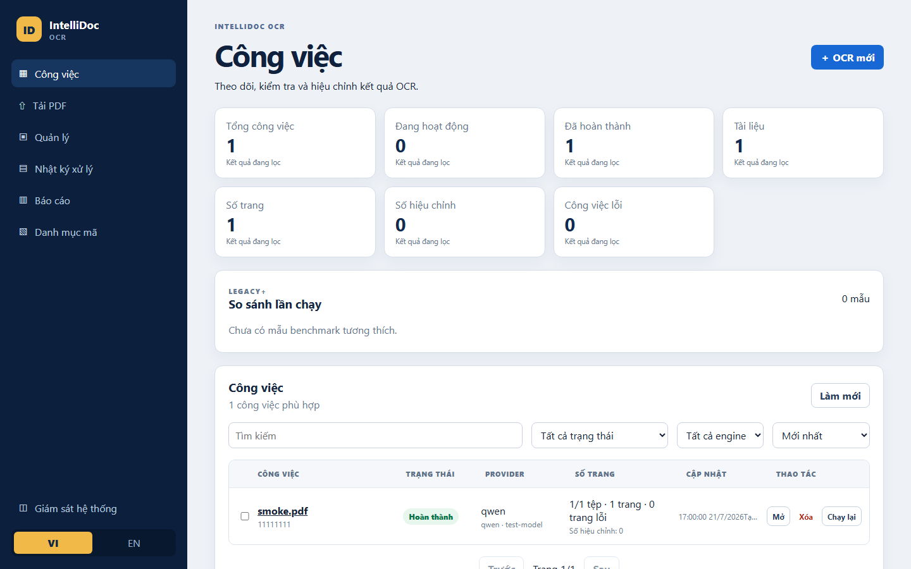
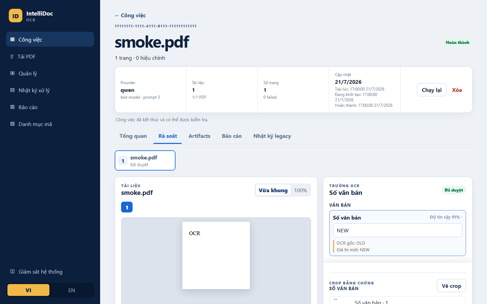

# IntelliDoc OCR – xử lý tài liệu hành chính tiếng Việt

IntelliDoc OCR là hệ thống chỉ nhận **PDF**, dùng để trích xuất, rà soát và phê
duyệt dữ liệu từ văn bản hành chính, bìa hồ sơ hoặc hồ sơ gộp. Hệ thống gồm
Next.js, FastAPI, Celery, Redis và một endpoint OCR tương thích OpenAI do máy
chủ cấu hình.

Các đặc điểm chính:

- Tải lên từng PDF hoặc chọn một thư mục chứa nhiều PDF.
- Xử lý ba chế độ: `administrative_document`, `dossier_cover` và
  `combined_dossier`.
- Rà soát phân đoạn, sửa dữ liệu, phê duyệt, vẽ Manual crop và lưu audit bền
  vững.
- Theo dõi job, log an toàn, báo cáo, Code Catalog, System Monitor và chi phí
  OCR trên giao diện VI/EN.
- Lưu JSON, PDF và artifact trong `data/jobs/`; Redis chỉ làm hàng đợi.

> **Phạm vi hiện tại:** Milestone A và B đã hoàn tất cục bộ. Milestone C vẫn là
> cổng thử nghiệm nội bộ gần giống production, không phải phê duyệt
> customer-production.

## Giao diện

| Dashboard | Không gian rà soát |
| --- | --- |
|  |  |

Các ảnh ẩn danh khác nằm trong [`docs/ui-parity/`](docs/ui-parity/) và
[`frontend/public/guide/`](frontend/public/guide/).

## Mục lục

- [Yêu cầu và phụ thuộc](#yêu-cầu-và-phụ-thuộc)
- [Cài đặt cục bộ](#cài-đặt-cục-bộ)
- [Cách sử dụng](#cách-sử-dụng)
- [Chạy bằng Docker Compose](#chạy-bằng-docker-compose)
- [Kiểm tra](#kiểm-tra)
- [Xử lý lỗi và câu hỏi thường gặp](#xử-lý-lỗi-và-câu-hỏi-thường-gặp)
- [Cấu trúc repository](#cấu-trúc-repository)
- [Ràng buộc kỹ thuật](#ràng-buộc-kỹ-thuật)
- [Tài liệu liên quan](#tài-liệu-liên-quan)
- [Trạng thái và lỗi đã biết](#trạng-thái-và-lỗi-đã-biết)

## Yêu cầu và phụ thuộc

### Công cụ

- Python 3.12 và `uv`.
- Node.js 22 và pnpm 10.
- Một Redis có thể kết nối khi chạy Celery trực tiếp.
- Docker Compose chỉ cần cho môi trường internal-pilot và Milestone C.
- Một endpoint OCR tương thích OpenAI do phía máy chủ cấu hình.

### Thành phần chính

- Frontend: Next.js và React, khai báo tại
  [`frontend/package.json`](frontend/package.json).
- Backend: FastAPI, Celery và các thư viện OCR, khai báo tại
  [`backend/pyproject.toml`](backend/pyproject.toml).
- Phiên bản Python được khóa trong [`backend/uv.lock`](backend/uv.lock).
- Nginx và Redis phục vụ deployment bằng Docker Compose.

## Cài đặt cục bộ

Chạy từ thư mục gốc của repository:

```powershell
Copy-Item .env.example .env
uv sync --project backend
pnpm install
```

Điền các giá trị provider thật vào `.env`. Đây là cấu hình chỉ dùng phía máy
chủ; không đưa URL, khóa hoặc header của provider xuống frontend.

Host Redis `redis` trong file mẫu dành cho Compose. Khi chạy Celery trực tiếp,
hãy đổi cả hai URL Celery sang một Redis mà máy đang chạy worker có thể kết nối.

## Cách sử dụng

### 1. Khởi động ứng dụng

Mở hai terminal riêng:

```powershell
uv run --env-file .env --project backend uvicorn app.main:app --host 0.0.0.0 --port 50177 --reload
pnpm --dir frontend dev -- --hostname 0.0.0.0 --port 54846
```

Mở <http://localhost:54846>. Frontend mặc định chuyển tiếp `/api/*` đến
`http://127.0.0.1:50177`.

Khởi động worker trong terminal thứ ba:

```powershell
uv run --env-file .env --project backend celery -A app.workers.tasks:celery_app worker --loglevel=INFO --concurrency=1 --prefetch-multiplier=1
```

### 2. Thực hiện một job OCR

1. Mở **Upload** và chọn tối đa 15 PDF, tổng dung lượng tối đa 200 MiB.
2. Chọn Provider Profile, chế độ xử lý và phạm vi trang.
3. Nếu endpoint là bên ngoài, xác nhận việc gửi ảnh trang ra endpoint đó.
4. Tạo job và bắt đầu xử lý.
5. Với hồ sơ gộp, rà soát và xác nhận cấu trúc trước khi tiếp tục trích xuất.
6. Mở workspace để kiểm tra OCR text, metadata, cảnh báo và bằng chứng crop.
7. Sửa các trường cần thiết rồi chọn **Save and approve** khi không còn blocker.
8. Xem artifact, Safe Events, báo cáo hoặc chạy lại job bằng
   `reuse_segmentation`/`resegment` khi cần.

Ví dụ với một hồ sơ nhiều PDF: đặt tên file theo đúng thứ tự mong muốn. Ở chế độ
`combined_dossier`, PDF đầu tiên được xem là một Bìa hoàn chỉnh; mỗi PDF sau là
một văn bản hoàn chỉnh. Nếu tải một PDF gộp duy nhất, hệ thống phân đoạn từng
trang và yêu cầu người rà soát xác nhận ranh giới.

Hướng dẫn đầy đủ có tại
[Hướng dẫn sử dụng](http://localhost:54846/guide) và
[Tra cứu tham số](http://localhost:54846/guide/reference).

### Cổng mặc định

| Thành phần | Địa chỉ |
| --- | --- |
| FastAPI chạy trực tiếp | `http://localhost:50177` |
| Next.js chạy trực tiếp | `http://localhost:54846` |
| Compose có xác thực | `http://10.6.18.76:54846` qua Nginx |
| Redis trong Compose | `redis:6380` |

`BACKEND_PORT` không được hỗ trợ; backend luôn lắng nghe tại `50177`.

## Chạy bằng Docker Compose

Nginx là service duy nhất publish host port tại `10.6.18.76:54846`; frontend,
backend, Redis và worker chỉ hoạt động trong mạng Compose. Deployment sẽ không
bind được nếu host không có IP này.

```bash
cp .env.example .env
# Không truyền password trên command line; lệnh sẽ hỏi hai lần bằng getpass.
uv run --project backend python -m app.auth hash-password
python -c "import secrets; print(secrets.token_hex(32))"
# Dán hai output lần lượt vào OCR_AUTH_PASSWORD_HASH và
# OCR_AUTH_SESSION_SECRET trong .env, rồi chỉnh các giá trị server-only còn lại.
docker compose config
docker compose up -d --build redis backend worker frontend nginx
docker compose ps
curl -fsS http://10.6.18.76:54846/health
curl -fsSI http://10.6.18.76:54846/login
```

Không dùng Compose với `OCR_DATA_DIR` thật cho đến khi đã dừng nhận upload,
drain worker và tạo bản sao lưu có checksum.

## Kiểm tra

Local contract gate không cần Redis, worker đang chạy, Docker, GPU hoặc provider
thật:

```powershell
uv run --project backend pytest backend/tests -q
pnpm --dir frontend typecheck
pnpm --dir frontend build
pnpm --dir frontend e2e:smoke
pnpm api:check
python -m compileall -q backend/app
git diff --check
```

Playwright kiểm tra workflow mock, một luồng Next/FastAPI/eager-task với fake
provider, desktop `1440×900`, laptop `1366×768` và safety smoke mobile
`390×844`. Các kiểm tra này không chứng minh hành vi Redis, Celery hoặc provider
trên live internal-pilot stack.

Khi schema FastAPI thay đổi, chạy `pnpm api:generate` và đưa cả
`frontend/openapi.json` lẫn `frontend/lib/api-schema.ts` vào cùng thay đổi.

## Xử lý lỗi và câu hỏi thường gặp

### Worker không kết nối được Redis

Giá trị host `redis` chỉ phân giải bên trong mạng Compose. Khi chạy worker trực
tiếp, cấu hình broker URL và result backend trỏ đến cùng một Redis mà máy local
có thể truy cập.

### Frontend không gọi được backend

Giữ request trình duyệt ở dạng tương đối `/api/*`. Mặc định Next.js proxy đến
`http://127.0.0.1:50177`; chỉ đặt `OCR_BACKEND_URL` khi backend thật sự chạy ở
URL khác.

### Không mở được frontend từ một máy LAN khác

Môi trường phát triển hiện cho phép `127.0.0.1` và `10.6.18.76`. Nếu dùng host
LAN khác, cập nhật `allowedDevOrigins` trong `frontend/next.config.ts`.

### Docker Compose báo lỗi bind

Compose auth hiện publish đúng IP `10.6.18.76`. Chỉ chạy cấu hình này trên host
có IP đó; không mở thêm cổng backend/frontend trực tiếp trong deployment auth.

### Sizing & Cost hiển thị `Unavailable`

Đây là hành vi có chủ ý khi provider chưa trả đủ usage hoặc chưa đạt sample và
coverage gate. Hệ thống không thay dữ liệu thiếu bằng số `0` hay dự báo giả.

Trong tab Scenario, chọn Provider Profile và model từ dropdown do backend đọc từ
`OCR_PROVIDER`/`OCR_MODEL`, chọn nguồn tỷ giá rồi chọn
`Lấy giá và tỷ giá`. Hệ thống chỉ đọc các nguồn chính thức đã cho phép, hiển thị
nguồn/thời điểm để người dùng kiểm tra và chỉ lưu Price Profile sau khi xác nhận.
Model chưa có bộ đọc giá chính thức tiếp tục hiển thị `Unavailable`.
Với cấu hình hiện tại, job mới dùng Provider Profile `minimax` và model
`MiniMax-M3`; các provider ID lịch sử vẫn đọc được và không bị tự động rewrite.

### Có thể tải ảnh hoặc ZIP không?

Không. Hệ thống chỉ nhận PDF. PDF có mật khẩu, không hợp lệ hoặc vượt giới hạn
sẽ làm toàn bộ job thất bại trước khi gọi provider.

### Local tests đã đủ để triển khai production chưa?

Chưa. Local tests là bằng chứng contract, không thay thế kiểm tra fixture thật,
provider thật, restart, Redis/Celery/Nginx, rollback và tải trên server mục tiêu.

## Cấu trúc repository

- `frontend/`: Next.js App Router và các kiểu API sinh từ OpenAPI.
- `backend/`: FastAPI, kho job bền vững, Celery worker và tests.
- `nginx/`: định tuyến deployment trên cùng một domain.
- `data/jobs/`: JSON, PDF và artifact bền vững; không lưu trong Redis.
- `docs/ui-parity/`: ảnh giao diện ẩn danh ở các viewport được hỗ trợ.
- `implementation_plan.md`: contract backend, Repair Gate, cutover và ledger
  bằng chứng Milestone C.
- `frontend_plan.md`: contract frontend, workflow và regression gate.
- `User_guide.md`: đặc tả nội dung và acceptance của hướng dẫn VI/EN.
- `Simple_Auth.md`: contract shared demo login `BE-X19`/`FE-X19`.
- `incomlpeted.md`: điều kiện nghiệm thu còn phụ thuộc fixture, provider, server
  hoặc operator.

## Ràng buộc kỹ thuật

- Chỉ nhận PDF: tối đa 15 file và 200 MiB mỗi job; tối đa 100 trang mỗi PDF.
- FastAPI chỉ xử lý request ngắn; Celery render trang ở 200 DPI và gọi provider.
- `/start` chỉ dispatch một lần. Worker production dùng concurrency `1`,
  prefetch `1`; job không tự retry hoặc tự resume toàn bộ.
- Mỗi thao tác provider có tối đa hai lần thử theo retry policy đã khóa.
- `data/jobs/` là nguồn dữ liệu bền vững duy nhất; Redis không có volume.
- Dữ liệu legacy vẫn đọc được và không bị tự động rewrite.
- Provider URL, khóa, header, phản hồi thô, lỗi không an toàn và cấu hình bí mật
  không được lưu hoặc gửi xuống frontend.
- Approval độc lập theo logical document. Rerun tạo job mới và không sửa job
  nguồn.
- Crop tự động chỉ là bằng chứng artifact; reviewer vẫn phải đối chiếu ngữ nghĩa
  hoặc vẽ Manual crop. Thiếu crop là risk, không phải blocker phê duyệt.
- Code Catalog được ghi atomic tại `OCR_DATA_DIR/_codes.json`; hệ thống không
  dùng database.
- System Monitor chỉ công bố telemetry allowlist mà backend nhìn thấy; không trả
  hostname, IP, username, path, process, raw command output, secret hoặc provider
  config.

## Tài liệu liên quan

- [Hướng dẫn người dùng](User_guide.md)
- [Kế hoạch backend và Milestone C](implementation_plan.md)
- [Kế hoạch frontend](frontend_plan.md)
- [Kế hoạch Token/Cost/Sizing](Token_Cal.md)
- [Đặc tả shared demo login](Simple_Auth.md)
- [Các điều kiện còn thiếu](incomlpeted.md)

## Trạng thái và lỗi đã biết

- `X7` và `X16` vẫn **IN PROGRESS** ở gate tổng thể do thiếu nghiệm thu
  fixture/provider live.
- `X14` còn thiếu benchmark fingerprint thật.
- `X17F` còn thiếu one-PDF/provider/fixture/server evidence.
- `X18` đã qua build và các kiểm tra không dùng browser; Playwright chưa có xác
  nhận teardown sạch trên Windows nên chưa được gọi là `LOCAL COMPLETE`.
- `X19` shared demo login/logout đã hoàn tất local nhưng còn thiếu bằng chứng
  Nginx, đóng direct port, rate limit và full OCR smoke trên deployment thật.
- Milestone C chưa có đủ bằng chứng bốn fixture, restart, persistence, Nginx,
  Redis, Celery, provider và rollback.

Điều kiện đóng từng mục được theo dõi tại
[`incomlpeted.md`](incomlpeted.md). Các kết quả local không phải chứng nhận
customer-production.
